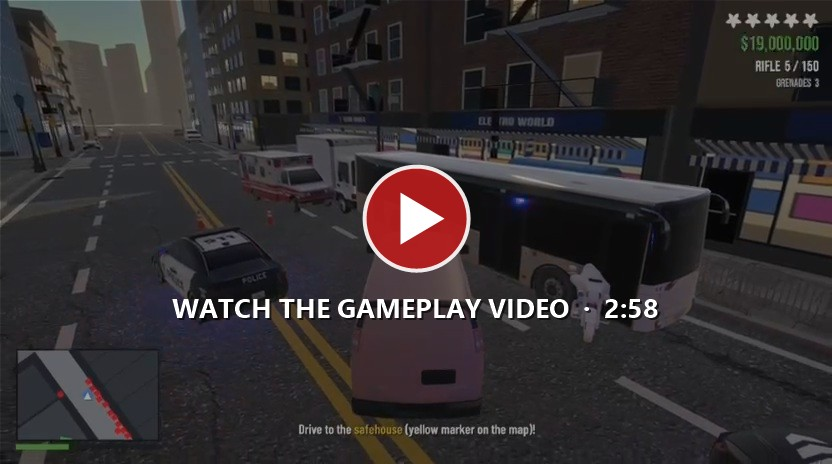
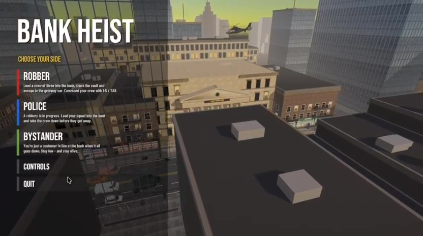
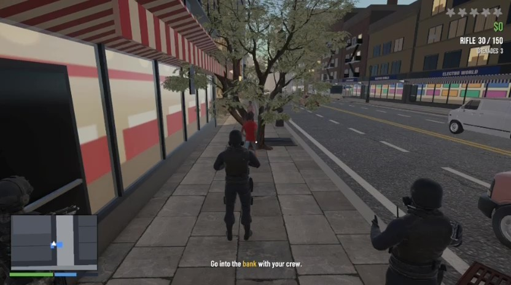
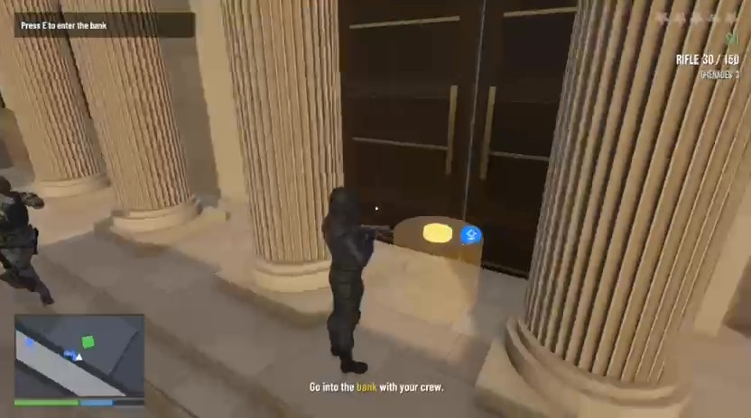
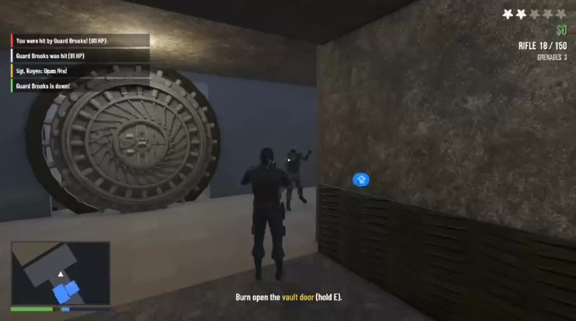
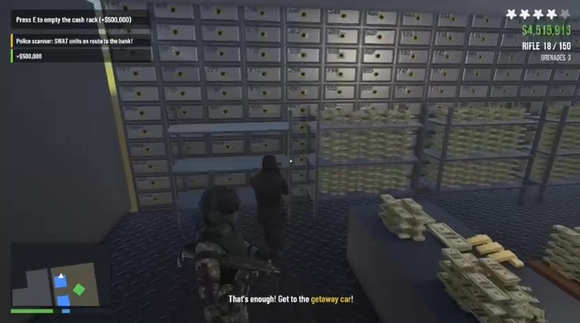
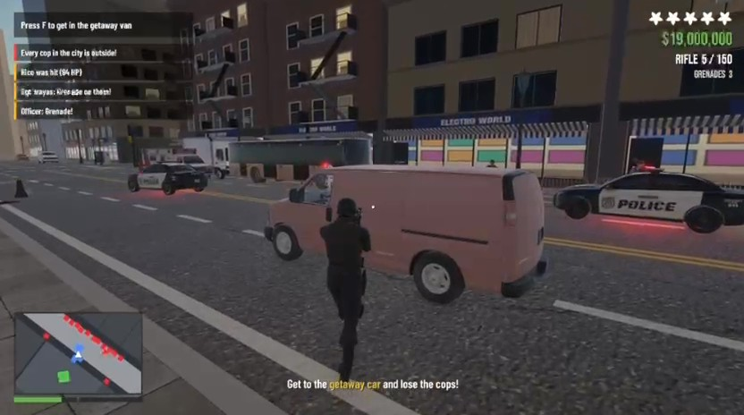
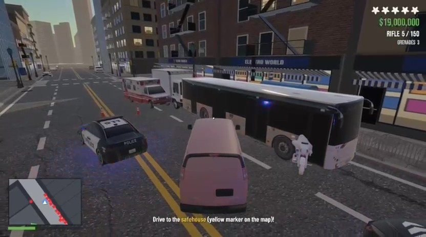
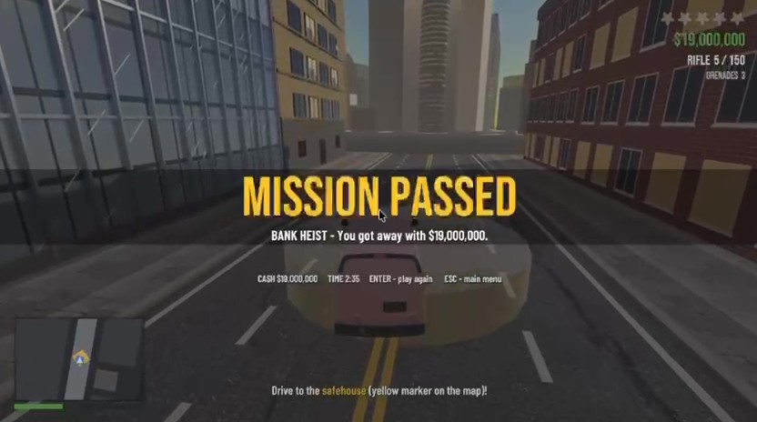

  
  
  
  

<b>Pick a side, plan the job, and survive the city.</b> 
A GTA-style 3D heist game across three connected scenes: the city streets, the bank and the vault.

---

## 🎬 Gameplay video

  
   
  <a href="https://github.com/omernof/bank-heist/releases/download/v1.0/BankHeist-Gameplay.mp4"><b>▶ Watch the full run</b></a> · 2:58 · <a href="https://github.com/omernof/bank-heist/releases/tag/v1.0">release page</a>

---

## 📸 Screenshots

<table>
  <tr>
    <td width="50%"> <b>Main menu</b> – choose Robber, Police or Bystander</td>
    <td width="50%"> <b>The city</b> – heading to the bank with the crew</td>
  </tr>
  <tr>
    <td> <b>The bank</b> – going in through the front door</td>
    <td> <b>The vault door</b> – burning it open while the squad covers</td>
  </tr>
  <tr>
    <td> <b>Inside the vault</b> – emptying the cash racks as SWAT is dispatched</td>
    <td> <b>The getaway</b> – out to the van with the police arriving</td>
  </tr>
  <tr>
    <td> <b>Police chase</b> – five wanted stars on the way to the safehouse</td>
    <td> <b>Mission passed</b> – got away with the money</td>
  </tr>
</table>

## 🎮 Gameplay

- **Three sides to play** – a **Robber** leading the crew, a **Cop** leading the response squad, or a **Bystander** caught in the middle
- **Three connected scenes** – City → Bank → Vault, with HP and loot carried between them
- **Commandable AI squad** – order your crew to follow, attack, throw grenades, retreat or hold (`1`–`5`, or the `Tab` command wheel); squad members keep their distance, take hits and can be killed
- **Reactive bank customers** – a queue of NPCs that lie down when the robbers break in
- **Drivable getaway vehicles** with an escalating police response: cruisers, a SWAT truck and a helicopter
- **GTA-style HUD** – wanted stars, cash counter, ammo, minimap, objectives and win / lose screens

## ⌨️ Controls

| Action | Key |
|---|---|
| Move / sprint | `W` `A` `S` `D` / `Left Shift` |
| Aim / shoot | Right mouse / Left mouse |
| Reload / grenade | `R` / `G` |
| Interact (hold for doors, vault, cash) | `E` |
| Enter / exit vehicle | `F` |
| Drive / handbrake | `W` `A` `S` `D` / `Space` |
| Lie down | `C` |
| Squad orders | `1` Follow · `2` Attack · `3` Grenade · `4` Retreat · `5` Hold |
| Command wheel | hold `Tab` |
| Free / lock the cursor | `Esc` |

## 🚀 Getting started

1. Install Unity **6000.5.7f1** with Universal 3D (URP) support.
2. Clone this repository and open the folder in Unity Hub.
3. Restore the large assets listed [below](#-not-included).
4. Choose **Tools ▸ Bank Heist ▸ Build All** to generate the scenes.
5. Press Play, or use the **Test:** menu items to jump straight into a scene.

## 🗂️ Project layout

| Path | Contents |
|---|---|
| `Assets/Heist/Scripts` | Game code: player, squad, AI, health, weapons, vehicles, HUD, scene flow |
| `Assets/Heist/Editor` | Editor tools that build the City, Bank and Vault scenes and the prefabs |
| `Assets/Heist/Props`, `Vehicles`, `Weapons` | 3D models and textures |
| `Assets/Mixamo` | Characters and animations |
| `_ref` | Reference scripts from earlier homework |

## 📦 Not included

To keep the repository small, the following are left out:

- `Library/`, `Logs/`, `Temp/`, `UserSettings/` – Unity regenerates them when the project opens
- Raw screen recordings – the gameplay video is on the [v1.0 release](https://github.com/omernof/bank-heist/releases/tag/v1.0)
- Asset files larger than 20 MB – some Mixamo characters/animations plus a few vehicle and tree models. Download them again into the same folders under `Assets/` ([Mixamo](https://www.mixamo.com)).

## 🙏 Credits

Vehicle and prop credits are in [`Assets/Heist/Vehicles/CREDITS.txt`](Assets/Heist/Vehicles/CREDITS.txt). Fonts: Bebas Neue, Barlow Condensed, Anton (OFL). Characters and animations: [Mixamo](https://www.mixamo.com).
