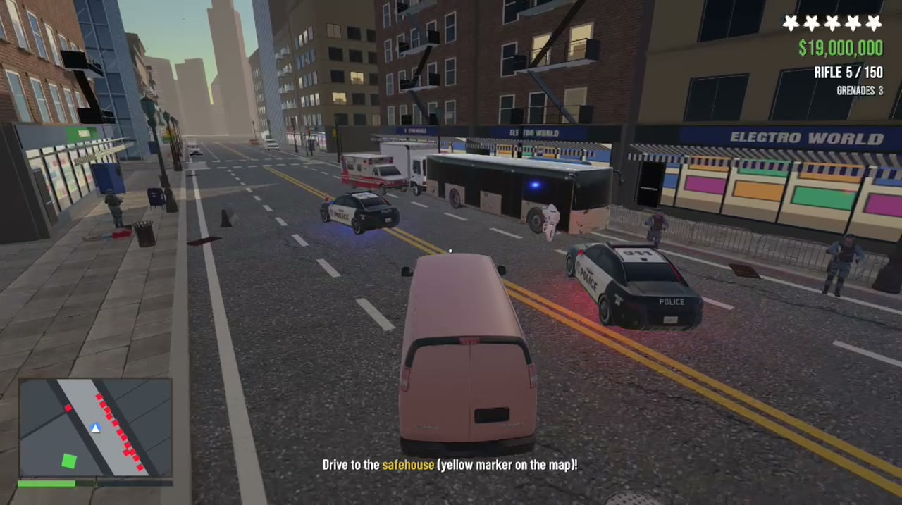
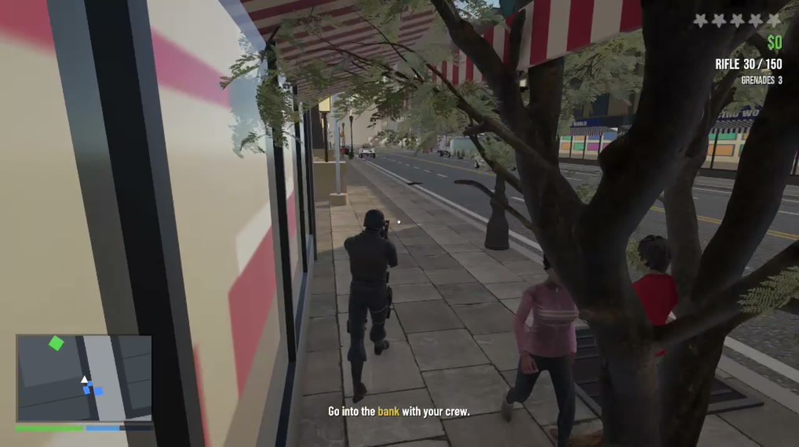
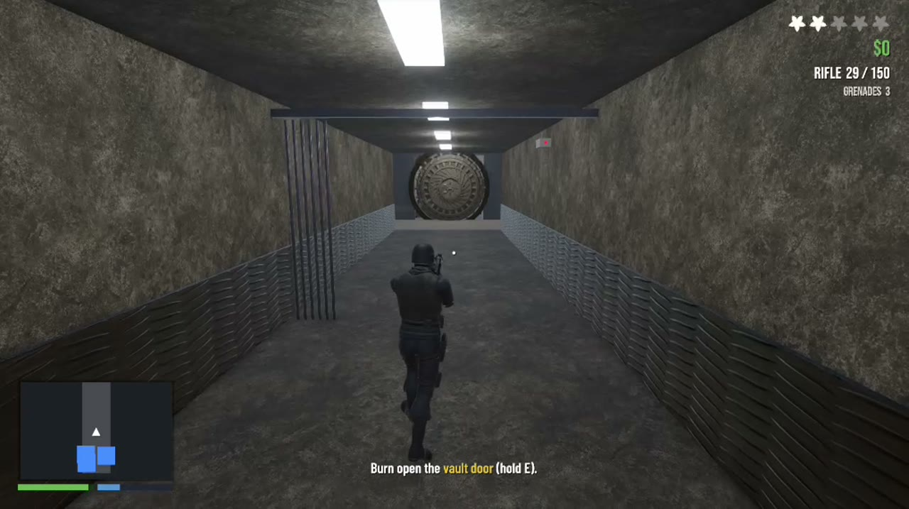
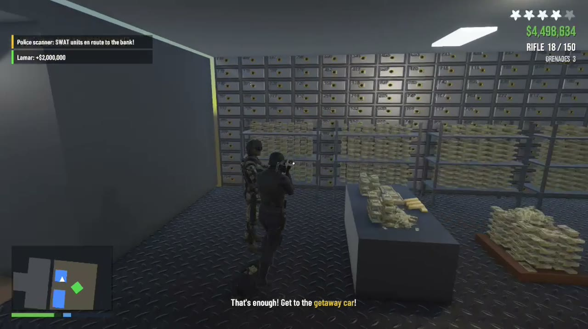

  
  
  
  

<b>Pick a side, plan the job, and survive the city.</b>

---

## Final project video

  
   
  <a href="https://github.com/ofekfanian/bank-heist/releases/download/v1.0/FinalProject.mp4"><b>Watch the video</b></a> · 3:15 · <a href="https://github.com/ofekfanian/bank-heist/releases/tag/v1.0">release page</a>

---

## Screenshots

<table>
  <tr>
    <td> Heading to the bank with the crew</td>
    <td> Burning open the vault door</td>
  </tr>
  <tr>
    <td> Inside the vault</td>
    <td> Getaway with the police on the tail</td>
  </tr>
</table>

## Gameplay

- **Main menu** – play as a **Robber**, a **Cop** or a **Bystander**
- **Three scenes** – City, Bank and Vault, with HP and gold carried between them
- **Squad commands** – order your crew to fire, throw grenades, retreat and more (`1`–`5` / `Tab` wheel)
- **AI squad** that keeps its distance, takes hits and can be killed
- **Customer queue** in the bank that lies down when the robbers break in
- **Drivable getaway vehicles**, with a police response of cruisers, a SWAT truck and a helicopter
- Win / lose messages, wanted stars and a minimap

## Getting started

1. Install Unity **6000.5.7f1** with Universal 3D (URP) support.
2. Open this folder in Unity Hub.
3. Restore the large assets listed [below](#-not-included).
4. Choose **Tools ▸ Bank Heist ▸ Build All** to generate the scenes.
5. Press Play, or use the **Test:** menu items to jump straight into a scene.

## Project layout

| Path | Contents |
|---|---|
| `Assets/Heist/Scripts` | Game code: player, squad, AI, health, weapons, vehicles, HUD, scene flow |
| `Assets/Heist/Editor` | Scene builders (City, Bank, Vault) and prefab tools |
| `Assets/Mixamo` | Character animations |
| `_ref` | Reference scripts from earlier homework |

## Not included

To keep the repository small, the following are left out:

- `Library/`, `Logs/`, `Temp/`, `UserSettings/` – Unity regenerates them when the project opens
- Raw screen recordings (the final video is on the [v1.0 release](https://github.com/ofekfanian/bank-heist/releases/tag/v1.0))
- Asset files larger than 20 MB – Mixamo characters/animations plus a few vehicle and tree models. Download them again into the same folders under `Assets/` ([Mixamo](https://www.mixamo.com)).

## Credits

Vehicle and prop credits are in [`Assets/Heist/Vehicles/CREDITS.txt`](Assets/Heist/Vehicles/CREDITS.txt). Fonts: Bebas Neue, Barlow Condensed, Anton (OFL). Animations: Mixamo.
